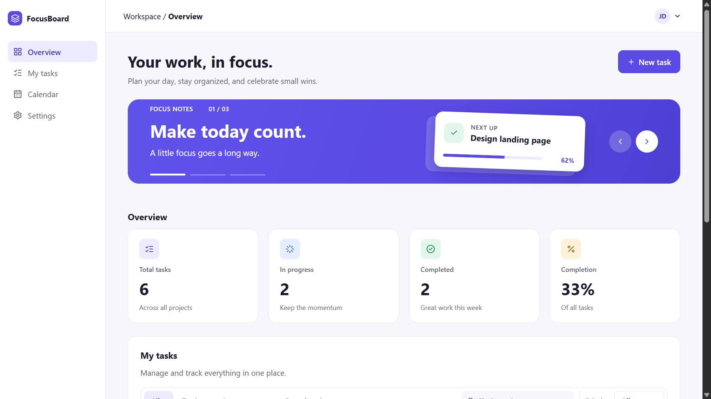
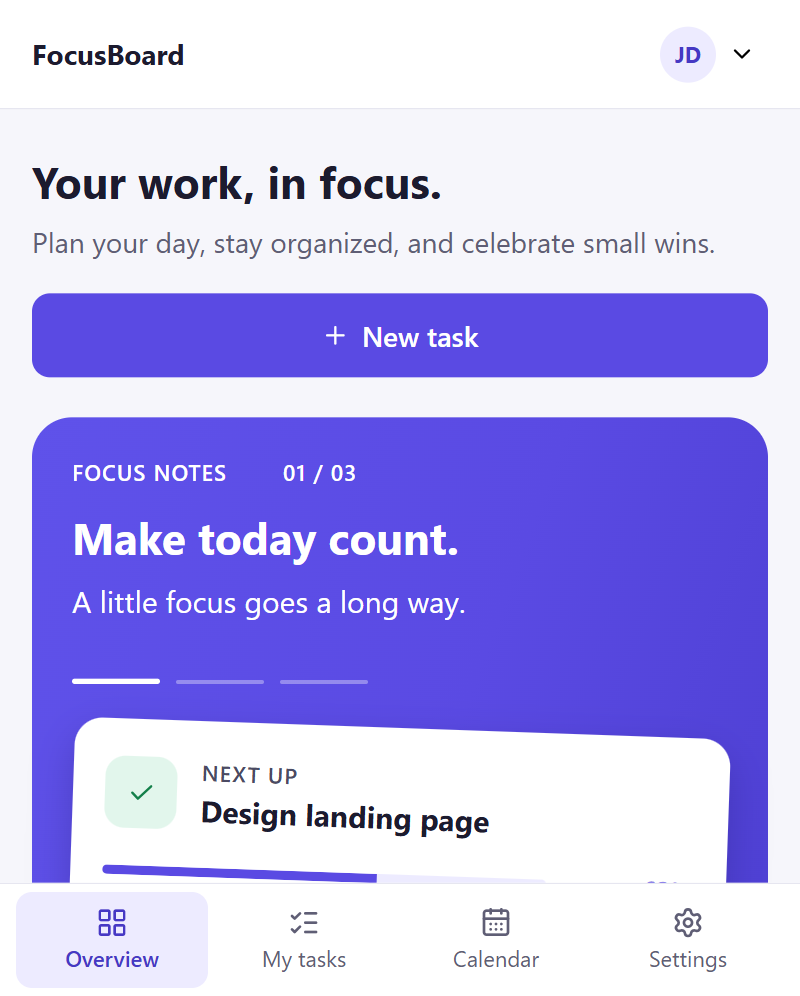

# FocusBoard

A responsive, single-user task dashboard built with **React** and **Vite**. Users can create, edit, delete, search and filter tasks, track progress through live statistics, and browse a three-slide Focus Notes carousel. All data is saved in the browser with localStorage.

- **Live demo:** https://YOUR-APP.vercel.app
- **Source code:** https://github.com/YOUR-USERNAME/focusboard

| Desktop (1440px) | Mobile (390px) |
|---|---|
|  |  |

## Tech stack

- React 18 with hooks (`useState`, `useEffect`, `useMemo`, `useRef`)
- Vite
- JavaScript (ES6+)
- Plain CSS (CSS variables and media queries)
- Lucide React (icons)
- localStorage (persistence)

## Features

- **Create, edit and delete tasks.** Create and edit use the same form component. Delete asks for confirmation first.
- **Status updates.** Each task can be To do, In progress or Completed, changed from a dropdown on the task row.
- **Search.** Case-insensitive, partial match on the task title.
- **Filters.** Status tabs (All, To do, In progress, Completed) and a priority filter (Low, Medium, High). Search, status and priority work together, and a Reset button clears all three.
- **Dynamic statistics.** Total, in progress, completed and completion percentage, calculated from the task data. Nothing is hard-coded, and zero tasks is handled without a division error.
- **Focus Notes carousel.** Three slides from the Figma design, with previous/next buttons, clickable indicators, an active-slide indicator and circular navigation.
- **Persistence.** Tasks are saved in localStorage and restored after a refresh. Sample data is loaded only when nothing has been saved.
- **Responsive.** Tested at 390px, 768px and 1440px. The sidebar becomes a bottom navigation bar on small screens.
- **Accessible.** Semantic HTML, labelled form fields, visible focus outlines, keyboard-operable controls and dialogs, and status shown by icon and text as well as colour.

## Getting started

**Requirements:** Node.js 18 or newer and npm.

```bash
# install dependencies
npm install

# start the development server (http://localhost:5173)
npm run dev

# create a production build in dist/
npm run build

# preview the production build locally
npm run preview
```

## Project structure

```
focusboard/
├── public/
├── screenshots/
│   ├── desktop.png
│   └── mobile.png
├── src/
│   ├── components/
│   │   ├── ConfirmDialog.jsx   # delete confirmation dialog
│   │   ├── FilterTabs.jsx      # status tabs + priority filter + reset
│   │   ├── FocusNotes.jsx      # three-slide carousel
│   │   ├── Header.jsx          # top bar
│   │   ├── SearchBar.jsx       # title search input
│   │   ├── Sidebar.jsx         # side / bottom navigation
│   │   ├── StatCard.jsx        # reusable statistic card
│   │   ├── TaskCard.jsx        # one task row
│   │   ├── TaskForm.jsx        # create + edit form (modal)
│   │   └── TaskList.jsx        # list and empty states
│   ├── data/
│   │   └── sampleTasks.js      # 6 sample tasks + status/priority/category lists
│   ├── hooks/
│   │   └── useLocalStorage.js  # state that syncs with localStorage
│   ├── App.jsx                 # owns the state and combines the components
│   ├── main.jsx
│   └── index.css
├── AI_USAGE.md
├── README.md
└── package.json
```

## State management

I used plain **React hooks** and no external library. The app is small, and all shared data lives in one parent component, so Redux or Zustand would add complexity without benefit.

- **Single source of truth.** `App.jsx` holds one `tasks` array. The task rows, statistics, tab counts, filters and form all read from it, so they can never disagree.
- **Predictable updates.** Add, edit, delete and status changes never mutate state directly. They create new arrays and objects with `map`, `filter` and the spread operator, for example `{ ...task, status: newStatus }`. Tasks are matched by their unique `id`, not by position.
- **Create vs edit.** One `TaskForm` serves both. It receives `task = null` to create, or an existing task to edit. The parent decides what to do in a single `saveTask` function, and an edit always keeps the original `id`.
- **Derived values.** The statistics, the tab counts and the list of visible tasks are calculated from `tasks` and the filter values with `useMemo`. They are never stored in their own state, so they update automatically after any change.
- **Filters.** Search text, selected status and selected priority are three separate state values. One filter function checks all three together. Filtering only changes what is displayed, so the full `tasks` array is never reduced or saved in filtered form.
- **UI state.** `formOpen`, `editing` and `deleting` control which dialog is open and for which task.
- **Carousel state.** The active slide index is local state inside `FocusNotes`, because nothing else needs it. Navigation uses `(index + length) % length` so it wraps around in both directions.

## localStorage implementation

The `useLocalStorage(key, initialValue)` hook works like `useState` but remembers the value in the browser.

1. On the first render, it reads the key `focusboard_tasks`. If nothing is saved, it returns the sample tasks, so **sample data never overwrites saved data**.
2. Saved text is parsed with `JSON.parse`. If it is corrupted or is not an array, the app falls back to the sample data instead of crashing.
3. A `useEffect` writes the latest array back with `JSON.stringify` whenever it changes.
4. Reading and writing are wrapped in `try/catch`, so blocked or full storage does not break the app. It just won't persist.

Only the full task list is stored. Search text and filters are not saved.

## Known limitations

- The sidebar items other than **Overview** are visual placeholders. There are no extra screens, as they are outside the assignment scope.
- Focus Notes slide content (titles, card names, percentages) is static, matching the Figma design, and is not connected to the task data.
- Spacing, colours and sizes were matched to the Figma file by eye, so small pixel differences are possible.
- There is no backend or login. Data lives only in the browser that created it, so tasks do not sync across browsers or devices.
- The "View all tasks" button and the row "…" menu shown in the Figma design are not implemented. Edit and delete are visible buttons on each row instead.

## Author

kosetti Prakash